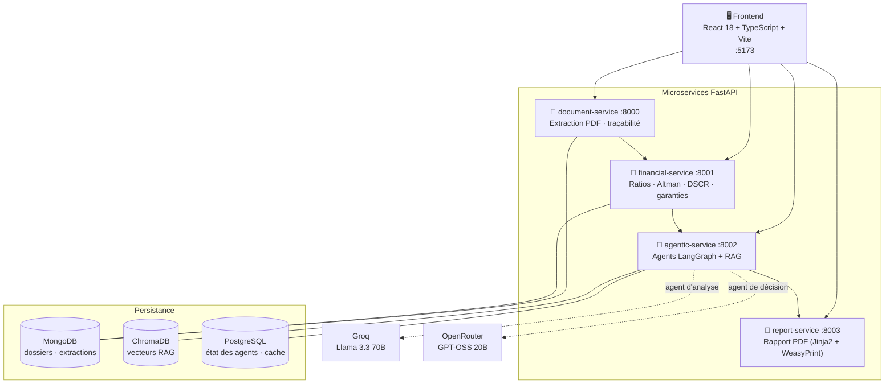

<div align="center">

# 🏦 Credit Risk Intelligence

### Plateforme d'instruction de dossiers de crédit entreprise assistée par IA agentique

*Le LLM planifie et rédige. Python calcule et décide.*

[](https://gitlab.com/fatima.bouhou/credit_risk_project/-/pipelines)


[Aperçu](#-aperçu) · [Principe](#-le-principe-directeur) · [Architecture](#-architecture) · [Démarrage rapide](#-démarrage-rapide) · [Tests](#-tests--qualité) · [Sécurité](#-sécurité) · [Limites](#-limites-connues)

</div>

---

## 📸 Aperçu

> 💡 Ajoutez vos captures dans `docs/screenshots/` (elles figurent dans le rapport, chapitre 8).

| Constitution du dossier | Analyse financière |
|:--:|:--:|
|  |  |
| **Radar du risque crédit** | **Rapport de crédit PDF** |
|  |  |

---

## 🎯 Contexte et problème

Dans une banque, l'instruction d'un dossier de crédit entreprise est un travail **long, peu homogène et difficile à auditer** : lecture de dizaines de pièces hétérogènes (bilans, CPC, attestations DGI/CNSS, relevés bancaires, Centrale des Risques de Bank Al-Maghrib, garanties), ressaisie des postes comptables, calcul de ratios, comparaison à des normes sectorielles, puis rédaction d'un avis.

La solution naïve, « brancher un LLM sur les PDF », échoue dans un contexte réglementé. Trois problèmes ont été **observés sur des prototypes** au début du projet :

| Problème observé | Conséquence |
|---|---|
| Le modèle **calcule** les ratios | Erreurs d'arithmétique, résultats différents d'un appel à l'autre |
| Le modèle **interprète** les normes sectorielles | Comparaison à la moyenne au lieu de la fourchette min/max → verdicts incohérents |
| Le modèle **tranche** la décision | Deux dossiers quasi identiques reçoivent des décisions différentes selon la formulation du prompt |

**Question centrale :** comment automatiser l'instruction de bout en bout en exploitant un système agentique, tout en garantissant que *chaque calcul, chaque verdict et chaque décision* restent **déterministes, reproductibles et auditables** ?

---

## 🧭 Le principe directeur

> **Tout ce qui doit être fiable est calculé en Python. Le LLM n'intervient que pour planifier et rédiger.**

| Tâche | Responsable | Pourquoi |
|---|---|---|
| Extraction des postes comptables | Code déterministe (`pdfplumber` + regex) | Chaque valeur doit être rattachable à sa page |
| Ratios, Altman Z, DSCR | Code déterministe | Même résultat à chaque exécution |
| Verdict « dans la norme / hors norme » | Code déterministe (comparaison min/max) | Seuil appliqué mécaniquement |
| Détection de patterns de risque | Moteur de règles déclaratif | Un pattern déclenché est explicable par ses conditions |
| **Score de risque et décision** | **Fonction de scoring pondérée et tracée** | Chaque point porte le nom du signal qui l'a produit |
| Mise en page du rapport | Template Jinja2 fixe | Présentation identique à chaque génération |
| Choix des outils à appeler et de leur ordre | 🤖 LLM (agent d'analyse) | Planification, sans effet sur les valeurs |
| Rédaction de la synthèse et de la justification | 🤖 LLM (agent de décision) | Rédaction à partir d'un verdict **déjà tranché** |

Le LLM n'apparaît que sur les deux dernières lignes, et **aucune de ces deux tâches ne produit de valeur chiffrée**. Aucun chiffre affiché, aucun verdict, aucune décision ne sortent de lui.

---

## 🏗️ Architecture



### Les services

| Service | Port | Rôle | Dépend d'un LLM |
|---|:--:|---|:--:|
| `document-service` | 8000 | Dépôt, extraction, traçabilité, persistance du dossier | ❌ |
| `financial-service` | 8001 | 21 ratios, Altman Z, DSCR, couverture des garanties, tendances | ❌ |
| `agentic-service` | 8002 | Benchmark sectoriel, patterns, conclusion, décision | ✅ |
| `report-service` | 8003 | Assemblage et mise en page du rapport de crédit | ❌ |
| `frontend` | 5173 | Tableau de bord, dépôt du dossier, restitution | ❌ |

> **Résilience par conception :** le service agentique est le seul à dépendre d'un fournisseur externe et d'un quota. S'il est indisponible, l'extraction et l'analyse financière restent pleinement fonctionnelles.

### Les bases de données

| Base | Contenu | Pourquoi ce choix |
|---|---|---|
| **MongoDB** | Dossiers clients, résultats d'extraction et d'évaluation | Documents hétérogènes, schéma souple |
| **ChromaDB** | Embeddings de la base de connaissances sectorielles | Recherche sémantique sur le corpus de normes |
| **PostgreSQL** | Checkpointer LangGraph, dernier résultat d'analyse | Persistance transactionnelle ; aucune donnée métier n'y transite |

---

## ✨ Fonctionnalités clés

### 📄 Extraction avec traçabilité native
- **5 extracteurs spécialisés** (administratif, conformité DGI/CNSS, financier, bancaire, garanties) pour **10 catégories de pièces**.
- Chaque valeur est un triplet **`{valeur, source, page}`** : il n'existe aucun chemin de code pour produire une valeur sans sa provenance. Tout chiffre affiché remonte à sa page d'origine.
- **14 postes comptables** sur 3 exercices, alertes de cohérence entre documents (ex. incident de paiement déclaré dans une pièce et absent d'une autre).
- Des **simulateurs de documents** (bilans, CPC, attestations, relevés Attijariwafa et CIH, Centrale des Risques, amortissement, garanties) servent de jeu de référence stable pour les tests.

### 🧮 Moteur de calcul financier déterministe
- **21 ratios** en 5 familles (liquidité, solvabilité, rentabilité, activité, flux de trésorerie). 16 ont un seuil de référence ; 5 sont volontairement affichés **sans verdict** (un fonds de roulement est un montant absolu : lui attribuer un seuil reviendrait à inventer une référence).
- **Score d'Altman** en 3 variantes, sélectionnée automatiquement :

| Modèle | Cas d'application | Zone de détresse | Zone saine |
|---|---|:--:|:--:|
| Z (1968) | Cotée et manufacturière | < 1,81 | ≥ 2,99 |
| Z' (1983) | Manufacturière non cotée | < 1,23 | ≥ 2,90 |
| Z'' (1995) | Commerce, services, BTP, transport (défaut) | < 1,10 | ≥ 2,60 |

- **DSCR** existant et après nouveau crédit (seuil 1,25 inclus). Si montant ou durée manquent, le nouveau crédit est marqué *non évaluable* : **aucune estimation n'est inventée**.
- **Garanties** valorisées après décote (hypothèque 70 %, nantissement 50 %, caution 0 %) ; une valeur illisible vaut « non déterminée », jamais zéro.

### 🤖 Système agentique encadré
- **Agent 1, analyse** : boucle **ReAct** sur un graphe LangGraph (Groq, Llama 3.3 70B) avec **7 outils** déterministes :

| Outil | Rôle |
|---|---|
| `outil_profil_client` | Profil administratif (secteur, taille, identité) |
| `outil_rapport_financier` | Ratios et indicateurs de `financial-service` |
| `outil_recherche_normes` | Recherche RAG dans la base de connaissances sectorielles |
| `outil_benchmark_sectoriel` | Comparaison de chaque ratio à sa fourchette, production des anomalies |
| `outil_patterns_croises` | Évaluation des patterns de risque univariés et croisés |
| `outil_tendances` | Évolution des indicateurs sur les exercices disponibles |
| `outil_validation_dossier` | Conformité réglementaire et alertes de cohérence |

- **Agent 2, décision** : appel indépendant chez un **fournisseur différent** (OpenRouter) : les deux quotas sont isolés. Il ne reçoit que le **diagnostic condensé**, jamais l'historique d'exploration, ce qui limite les tokens et empêche le raisonnement intermédiaire d'influencer la décision.
- **RAG** : corpus de fiches sectorielles, embeddings `BAAI/bge-m3`, index ChromaDB.
- **Moteur de patterns déclaratif** : le LLM reçoit les patterns déclenchés comme une donnée d'entrée, il ne les déclenche jamais.
- **Garde-fou d'échec** : après 2 erreurs d'outil consécutives, le graphe produit une conclusion d'échec déterministe plutôt qu'un appel LLM supplémentaire.
- **Isolation** : chaque analyse a un identifiant de fil unique (client + exécution), aucun contexte ne fuit entre deux analyses. Raisonnement tracé dans **LangSmith**.

### ⚖️ Un score de risque auditable

La décision est une **somme de points, chacun rattaché à un signal nommé**, comparée à deux seuils fixes.

| Signal | Points |
|---|:--:|
| Pattern de risque élevé | 3 |
| Pattern de risque modéré | 1 |
| Anomalie sectorielle de sévérité élevée | 2 |
| Altman en zone *distress* | 4 |
| Altman en zone *grey* | 2 |
| DSCR insuffisant | 3 |
| DSCR après nouveau crédit non évaluable | 5 |
| Couverture des garanties < 100 % | 2 |
| Tendance dégradée sur plusieurs indicateurs | 2 |
| Non-conformité réglementaire (DGI ou CNSS) | 5 |
| Incident de paiement (Centrale des Risques BAM) | 5 |

| Score | Décision | Niveau de risque |
|:--:|---|---|
| 0 à 3 | ✅ **Accord** | Faible |
| 4 à 7 | ⚠️ **À surveiller** | Modéré |
| ≥ 8 | ⛔ **Refus** | Élevé |

- **Pas de double comptage** : une anomalie sectorielle portant sur un ratio déjà couvert par un pattern déclenché est écartée.
- Un DSCR *non évaluable* (5 pts) pèse **plus** qu'un DSCR *insuffisant* (3 pts) : dans le premier cas on ignore, dans le second on sait.
- Le résultat est une liste de couples `libellé / points` dont la somme est **exactement** le score, restituée telle quelle dans l'interface.

### 🖥️ Interface et rapport
- Tableau de bord React en **5 vues** : dépôt du dossier (assistant en étapes), intelligence documentaire, analyse financière, radar du risque crédit, guide de la plateforme.
- CSS écrit à la main et visualisations en **SVG** (aucun framework CSS, aucune bibliothèque de graphiques).
- La page de guide est **générée** à partir des mêmes définitions que le tableau des ratios : la documentation ne peut pas diverger du code.
- **Rapport PDF** (Jinja2 + WeasyPrint) à mise en page strictement identique d'une génération à l'autre, et aperçu HTML.
- Principe d'honnêteté visuelle : un compteur à zéro s'affiche en gris, pas en rouge ; une donnée absente reste absente.

---

## 🚀 Démarrage rapide

### Prérequis
- [Docker](https://docs.docker.com/get-docker/) et Docker Compose
- Une clé API **Groq** et une clé API **OpenRouter** (offres gratuites suffisantes pour tester)
- *(Optionnel)* une clé **LangSmith** pour tracer le raisonnement des agents

### Installation

```bash
# 1. Cloner le dépôt
git clone https://github.com/fatimabouhou/credit-risk-project.git
cd credit-risk-project

# 2. Configurer les variables d'environnement
cp .env.example .env
# puis renseigner les clés (voir tableau ci-dessous)

# 3. Lancer les 9 conteneurs
docker compose up --build
```

### Variables d'environnement

| Variable | Description |
|---|---|
| `GROQ_API_KEY` | Clé du fournisseur de l'agent d'analyse |
| `OPENROUTER_API_KEY` | Clé du fournisseur de l'agent de décision |
| `LANGSMITH_API_KEY` | *(optionnel)* observabilité des agents |

> Adaptez ces noms à ceux de votre fichier `.env.example`.

### Accès

| Interface | URL |
|---|---|
| 🖥️ Application | http://localhost:5173 |
| 📄 document-service (Swagger) | http://localhost:8000/docs |
| 🧮 financial-service (Swagger) | http://localhost:8001/docs |
| 🤖 agentic-service (Swagger) | http://localhost:8002/docs |
| 📑 report-service (Swagger) | http://localhost:8003/docs |
| 🗄️ mongo-express | http://localhost:8081 |

### Parcours de démonstration

1. Ouvrir l'application et **saisir un identifiant client**.
2. **Déposer les pièces** : fiche de renseignements et au moins un bilan (obligatoires) ; DGI, CNSS, relevés, Centrale des Risques, amortissement, garanties (facultatifs, ils affinent l'analyse). Des PDF simulés sont fournis dans le dépôt.
3. Lancer l'extraction : le calcul financier démarre automatiquement.
4. Consulter l'**analyse financière** : ratios, Altman, DSCR.
5. Lancer l'**analyse agentique** : voir le radar du risque, la décomposition du score et la recommandation.
6. Ouvrir ou télécharger le **rapport de crédit PDF**.

---

## 🧪 Tests et qualité

**292 tests automatisés**, concentrés sur les zones où une erreur serait **silencieuse** (résultat plausible, aucun message d'erreur, mais présent jusque dans la décision) :

| Suite | Outil | Tests | Ce qui est vérifié |
|---|---|:--:|---|
| `financial-service` | pytest | 64 | Altman, DSCR, garanties |
| `document-service` | pytest | 80 | Lecture des montants et colonnes, lien valeur → page, ordres de grandeur (erreur de virgule × 1000) |
| `agentic-service` | pytest | 70 | Score de risque, seuils de décision, gestion des échecs d'outils |
| `frontend` | Vitest | 78 | Formatage, verdicts, score de santé, radar |
| **Total** | | **292** | |

Les textes générés par le LLM ne sont volontairement **pas** testés (formulation non déterministe) ; le calcul de la décision l'est intégralement.

```bash
# Backend (exemple : financial-service)
cd financial-service
poetry install
poetry run pytest

# Frontend
cd frontend
npm ci
npx tsc --noEmit   # vérification de typage
npx vitest run
```

### Intégration continue (GitLab CI)

Le fichier `.gitlab-ci.yml` exécute à chaque merge request et sur `main` :

- `test:financial-service`, `test:document-service`, `test:agentic-service`, `test:frontend` (avec rapports JUnit)
- `build:frontend` (bundle de production)
- 4 travaux de sécurité : `security:sast`, `security:secrets`, `security:dependances`, `security:conteneurs`

Chaque travail ne se déclenche que si son dossier a changé. Pour le service agentique, un fichier de dépendances de test dédié évite d'installer près de 2 Go (PyTorch) pour tester une fonction arithmétique.

---

## ⚡ Optimisation mesurée

La génération du rapport prenait plus de deux minutes : le `report-service` relançait **entièrement les deux agents** même quand l'analyse venait d'être affichée. Corrections : cache du résultat dans PostgreSQL (écriture non bloquante) et appels inter-services en **parallèle**.

| Opération | Avant | Après |
|---|:--:|:--:|
| Aperçu du rapport | 128,2 s | **0,17 s** |
| Export PDF | en échec | **1,47 s** |
| Lecture de l'analyse enregistrée | inexistante | **0,04 s** |

---

## 🔐 Sécurité

Revue statique en 4 passes : **Bandit** et **Semgrep** (code Python/TypeScript, 267 règles), **Gitleaks** (secrets sur tout l'historique Git), **Trivy** (dépendances et conteneurs), **Hadolint**, `pip-audit` et `npm audit`.

| Sévérité | Constat | Statut |
|:--:|---|---|
| Haute | Traversée de chemin sur `POST /analyze/{client_id}` : la garde existait mais sur la mauvaise route | ✅ Corrigé |
| Moyenne | `mongo-express` exposé sans authentification | ✅ Corrigé |
| Moyenne | MongoDB, PostgreSQL et ChromaDB publiés sur l'hôte | ✅ Liés à `127.0.0.1` |
| Moyenne | Dépendances `cryptography` et `pypdf2` vulnérables | ✅ Corrigé |
| Basse | Conteneurs exécutés en root (5 Dockerfile) | ✅ Utilisateur dédié |
| Basse | Mot de passe PostgreSQL de repli codé en dur | ✅ Corrigé |
| Basse | Modèle HuggingFace non épinglé | ✅ Révision figée |
| Basse | `node_modules` versionné | ✅ Corrigé |
| Moyenne | Absence d'authentification sur les 4 API | ⏳ **Non traité**, décision assumée et documentée |

Le détail figure dans [`SECURITE.md`](SECURITE.md).

---

## 📁 Structure du dépôt

```text
credit-risk-project/
├── document-service/     # Extraction PDF, traçabilité, simulateurs de documents
├── financial-service/    # Ratios, Altman Z, DSCR, garanties
├── agentic-service/      # Agents LangGraph, RAG, moteur de patterns, scoring
├── report-service/       # Rapport de crédit (Jinja2 + WeasyPrint)
├── frontend/             # React 18 + TypeScript + Vite
├── docker-compose.yml    # Orchestration des 9 conteneurs
├── .gitlab-ci.yml        # Tests + sécurité + build
├── SECURITE.md           # Revue de sécurité statique
└── README.md
```

---

## 🧱 Stack technique

| Catégorie | Technologies |
|---|---|
| Backend | Python 3.11 / 3.12, FastAPI, Uvicorn, Pydantic, httpx |
| Agents | LangGraph, LangChain, LangSmith |
| Modèles | Groq (Llama 3.3 70B), OpenRouter (GPT-OSS 20B) |
| RAG | sentence-transformers (`BAAI/bge-m3`), ChromaDB |
| Extraction | pdfplumber, expressions régulières |
| Rapport | Jinja2, WeasyPrint |
| Données | MongoDB, PostgreSQL, ChromaDB |
| Frontend | React 18, TypeScript, Vite, CSS natif, SVG |
| Qualité | pytest, Vitest, GitLab CI/CD |
| Sécurité | Bandit, Semgrep, Gitleaks, Trivy, Hadolint |
| Infra | Docker, Docker Compose, Poetry |

---

## ⚠️ Limites connues

L'honnêteté fait partie de la conception du projet :

- **Données 100 % simulées.** Aucun accès à de vrais dossiers bancaires ; tous les essais utilisent les générateurs de documents du projet.
- **Normes sectorielles simulées.** Le corpus RAG est un ensemble de **repères de plausibilité construits pour l'exercice**, pas des statistiques de marché officielles. Cette mention figure dans le corpus, le code et le guide de l'interface.
- **Pas d'authentification** sur les API (décision assumée, voir [Sécurité](#-sécurité)).
- **Aide à la décision, pas décideur autonome** : la validation humaine reste nécessaire.
- Pas d'intégration aux systèmes d'information bancaires existants.

### Perspectives
- Raccordement à une source officielle de statistiques sectorielles
- Tests des enchaînements entre services et de la qualité du RAG (pertinence des fragments, questions hors corpus)
- Revue humaine structurée pour les dossiers « à surveiller », avec traçabilité de la validation
- Déploiement orchestré avec authentification et gestion des habilitations

---

## 🎓 Contexte du projet

Projet de fin d'année (PFA) réalisé **seule, de bout en bout**, du 26 juin au 1er septembre 2026, au sein de **Devoteam Cyber Trust Maroc** (Business Unit Ingénierie Cyber & Solutions), dans le cadre du cycle ingénieur **Génie Informatique** de l'**ENSA Kénitra** (Université Ibn Tofail).

Conception de l'architecture, 4 microservices, système agentique, interface web, conteneurisation, tests et intégration continue.

---

## 👩‍💻 Auteure

**Fatima Bouhou**, étudiante-ingénieure en Génie Informatique, ENSA Kénitra

[](https://linkedin.com/in/fatima-bouhou)
[](https://github.com/fatimabouhou)

---

<div align="center">

*« La fiabilité d'un système d'IA appliqué à un domaine réglementé ne vient pas de la qualité du modèle, mais de la rigueur avec laquelle on délimite ce qu'on lui confie. »*

</div>
